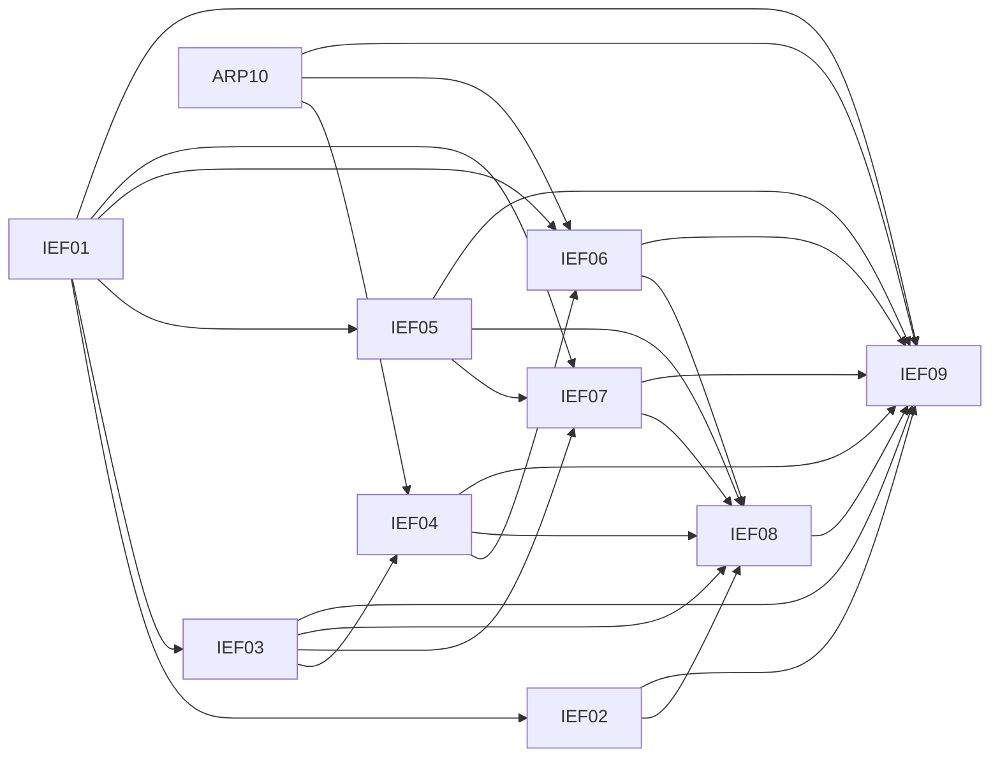

# Issue Graph

Kanten zeigen vom blockierenden Voraussetzungspaket zum abhängigen Paket. Native GitHub-Dependencies werden zusätzlich zu Managedblockverweisen gesetzt und in beiden Richtungen zurückgelesen. Keine Änderung/Schließung fremder Issues.

| Paket | Direkte Voraussetzungen |
| --- | --- |
| IEF-01 | keine |
| IEF-02 | IEF-01 |
| IEF-03 | IEF-01 |
| IEF-04 | IEF-03, ARP-10 |
| IEF-05 | IEF-01 |
| IEF-06 | IEF-01, IEF-04, ARP-10 |
| IEF-07 | IEF-01, IEF-03, IEF-05 |
| IEF-08 | IEF-02, IEF-03, IEF-04, IEF-05, IEF-06, IEF-07 |
| IEF-09 | IEF-01, IEF-02, IEF-03, IEF-04, IEF-05, IEF-06, IEF-07, IEF-08, ARP-10 |

## Technische Begründung

IEF-01 liefert Verträge und Routerbasis, keine vorgetäuschte Endpunktimplementierung. IEF-02/03/05 können danach unabhängig entstehen. IEF-04 braucht die konsistente Portfolioquelle und ARP-10 für den neuen optionalen externen Erklärungszweck. IEF-06 verbindet die lokale Analysequelle und Researchruns und wartet auf ARP-10; reine Bestandsdiagnose ist keine produktive Startfreigabe. IEF-07 benötigt Portfolio- und Strategiekontext, behält aber alle aktuellen Executiongates. IEF-08 integriert erst vorhandene Bereiche. IEF-09 wartet auf alle Pakete plus ARP-10; native direkte Kanten halten die Abnahme sichtbar blockiert.

ARP-10 = #105, am ersten Discoveryzeitpunkt offen, nach aktualisiertem Remotecheck auf0442f29 CLOSED; technische Voraussetzung erfüllt, Provenienzkanten bleiben. APF, QSL, Paper und ARP-01–09 sind bestehende geschlossene Voraussetzungen und werden nicht erneut als IEF-Arbeit geöffnet oder verändert. Ein späterer Daily-Briefing- oder Market-Intelligence-Change ist kein derzeitiger Dependencyknoten. Graph ist azyklisch; ARP-10 ist ein externer Wurzelknoten.

## GitHub-Issues

| Paket | Issue |
| --- | --- |
| IEF-01 | [[IEF-01] Experience Architecture und API Contracts](https://github.com/fjure/agentic-trading-platform/issues/107) |
| IEF-02 | [[IEF-02] Guided Onboarding](https://github.com/fjure/agentic-trading-platform/issues/108) |
| IEF-03 | [[IEF-03] Portfolio Hub](https://github.com/fjure/agentic-trading-platform/issues/109) |
| IEF-04 | [[IEF-04] Portfolio Insights und begrenzte Erklärung](https://github.com/fjure/agentic-trading-platform/issues/110) |
| IEF-05 | [[IEF-05] Strategy Discovery](https://github.com/fjure/agentic-trading-platform/issues/111) |
| IEF-06 | [[IEF-06] AI Task Center](https://github.com/fjure/agentic-trading-platform/issues/112) |
| IEF-07 | [[IEF-07] Guided Paper Order](https://github.com/fjure/agentic-trading-platform/issues/113) |
| IEF-08 | [[IEF-08] Personal Cockpit und Activity Timeline](https://github.com/fjure/agentic-trading-platform/issues/114) |
| IEF-09 | [[IEF-09] Integrated Experience Acceptance](https://github.com/fjure/agentic-trading-platform/issues/115) |

## Refinement

Der Prototyp liegt in IEF-01, das bereits vor den abhängigen Featurepaketen und transitiv vor IEF-08 liegt. IEF-07 hängt bereits von IEF-05 ab. IEF-09 hängt von allen erforderlichen Paketen ab. Die menschliche Abnahme ist ein Nachweis innerhalb der bestehenden Pakete. Es entsteht keine neue technische Voraussetzung zwischen Issues.
