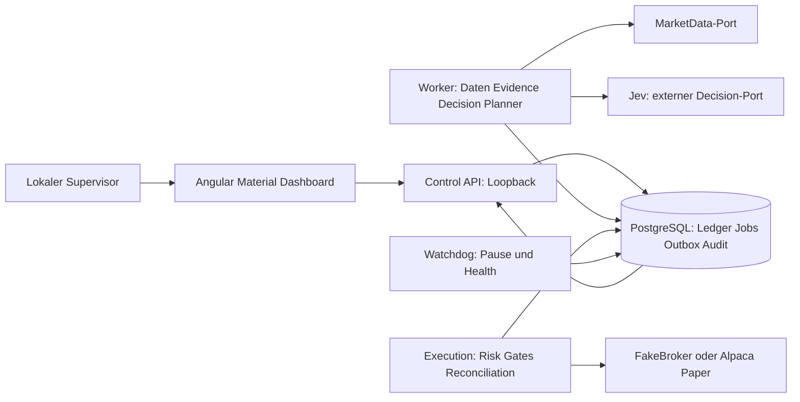
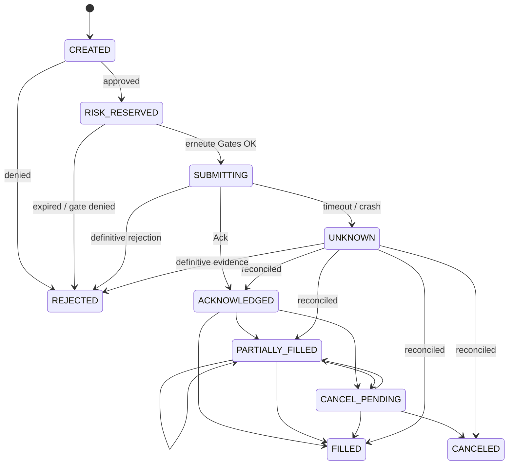

# Design

## Context

Siehe `proposal.md` für Motivation. Es existiert noch keine Anwendung, kein Commit und keine Main-Branch-Vertragsbasis. Die vorliegenden Verträge sind Initialverträge, kein erfolgreich geprüfter Diff gegen eine erfundene Baseline. Aktuelle Quellen und Zielversionen stehen in `docs/development/technology-baseline.md`; Generator-/Validator-Evidenz in `docs/development/contract-validation.md`. Die Definition of Ready und Runtime-Zertifizierung sind getrennte Gates.

## Goals / Non-Goals

**Goals:** Ein lokal reproduzierbarer Fake-Durchstich; externe Dienste hinter Ports; ein Execution-Prozess mit deterministischen Gates; beobachtbare, dauerhafte Zustände statt angenommener Exactly-once-Zustellung.

**Non-Goals:** Die initiale Planungsphase implementiert keine Anwendung; danach ist ein gesondert freigegebener Apply zulässig. Keine Brokercredentials im Agentenkontext, keine Brokerorders durch Entwicklungsagenten, LIVE-Konfiguration, Strategiegenerierung oder autonome Freigabe. Der Client des Planungsdurchlaufs ist ein temporäres Prüfergebnis; PTV-03 integriert später den reproduzierbar generierten Anwendungsclient.

## Decisions

### D-01: Prozesse und Trust Boundaries (ADR 0001)

Modularer Monolith mit Control API, Worker, Execution und kleinem unabhängigem Watchdog. Gemeinsame Python-Packages sind fachlich getrennt; Prozesse besitzen unterschiedliche DB-Rollen, Secretmounts und Netzfreigaben. Alternative Microservices/Kafka/Kubernetes bringt für einen lokalen MVP unnötige Transaktionen und Betriebskosten. PostgreSQL ist Source of Truth; HTTP wartet nur auf lokale Transaktionen, externe Entscheidungen/Ausführung laufen als Jobs.



Agenten/Worker besitzen weder BrokerAdapter-Submit-Port noch Paper-Broker-Key. Execution erhält den einzigen Brokerkey; Jev-Key ausschließlich Decision-Adapter. Da Alpaca-Marktdaten authentifiziert sein können, holt ein fest verdrahteter MarketData-Gateway innerhalb der Execution-Grenze read-only Marktdaten und publiziert normalisierte DTOs. Worker konsumiert diese DTOs über DB/Jobs; keine Credentialweitergabe. Dieser Gateway hat keine agentische Toolausführung. Fake/Replay erfordert keine externen Secrets.

Netzwerk: Execution allowlistet ausschließlich den festen Paper-Host und benötigte offizielle Data-Hosts; Base-URL darf nicht aus Nutzereingaben ersetzt werden. Worker besitzt nur Jev-Egress, API/UI/Watchdog keinen Broker-Egress. PAPER-Konfiguration verbietet `LIVE` und echte Orderhosts bereits beim Laden. Fehlt eine bestätigte Capability, wird die Operation abgelehnt.

### D-02: Typisierte Ports und Grenzen

| Port | Eingabe → Ergebnis | Geplante Adapter / Fehler |
|---|---|---|
| MarketDataProvider | Instrument, Session, Cursor → geschlossene MarketBar/Quality | AlpacaMarketDataProvider, Replayfixture; STALE_DATA, RATE_LIMIT, UNAVAILABLE |
| BrokerAdapter | Capability-Abfrage; unveränderlicher geprüfter Intent → Ack; IDs → Status/Reports | FakeBrokerAdapter, AlpacaPaperBrokerAdapter; UNKNOWN statt Retry nach unklarem Submit |
| DecisionEngine | MarketState, Konfigversion → DecisionResult | MockDecisionEngine, DeterministicBaselineDecisionEngine, JevDecisionEngine; ABSTAIN bei Fehler |
| EvidenceProvider | Instrument/asOf → EvidenceBundle | NeutralEvidenceProvider/simulierte Daten; keine produktive News/PDF-Ingestion |
| Clock | keine Eingabe → UTC now | Systemclock oder injizierte Replayclock |
| IdGenerator | Namensraum/Seed → ID | Produktions-UUID bzw. deterministischer Replaygenerator |
| EventPublisher | versioniertes Envelope → dauerhaft akzeptiert | transaktionale Outbox; at-least-once |

Vendorpayloads bleiben privat im jeweiligen Adapter. Keine rohen Alpaca-/Jev-Daten an HTTP/UI; Audit enthält normalisierte Ergebnisse und Metadaten. Ein späterer IBKR-/CCXT-Adapter muss dieselben Zertifizierungstests bestehen; capabilitybezogene Einschränkungen sind kein Domain-Umbau.

### D-03: Domainmodell, Decimal und Zeit

Öffentliche Entity-IDs sind stabile opake Strings; Verbraucher dürfen aus Präfixen oder Formaten keine Fachlogik ableiten. Persistierte interne Schlüssel können UUID sein; Beispiele verwenden synthetische IDs wie `ord_1`. Preise/Geld/Mengen `Decimal`, DB `NUMERIC(38,18)` mit expliziter Reject-Prüfung vor Speicherung bei Überlauf/Skalenverlust. Keine implizite Rundung: Mengen bei Buy zum bestätigten Brokerstep abwärts; Preise nur nach bestätigtem Tick; nicht bestätigte Steps → Ablehnung. Decimalstrings besitzen keine Exponenten oder NaN/Infinity. Währung und Instrument stehen bei jedem Geld-/Mengenbezug fest. Zeitspalten `timestamptz`, API UTC `Z`; exchangebezogene Sessions benutzen IANA `America/New_York`, niemals feste UTC-Offsets.

| Modell | Kernfelder und Invarianten |
|---|---|
| Instrument | interne ID, Markt, Broker-Symbol, assetClass, Currency, Steps, Sessions, versionierte Capabilities |
| MarketBar | instrumentId, start/end, OHLCV, timeframe=15m, closed, eventTime, receivedAt, availableAt, quality |
| EvidenceBundle | Quellenreferenzen, Aktualität, Konfliktflags; neutral ausdrücklich gekennzeichnet |
| MarketState | instrument/market/asOf, eventTime/receivedAt/availableAt, geschlossene Bar, Features, Spread, Alter/Quality, Portfolio/Position, Evidence |
| DecisionResult | typedAnswer, distributions/confidence, modelId, question/prompt/configVersion, inputHash, latencyMs, usage/cost nullable, traceId, validUntil, LONG/FLAT/ABSTAIN |
| TradeProposal | immutable ID/Input/Decisionreferenz, Ziel LONG/FLAT, Menge/Limit, Reasoncodes, createdAt/validUntil |
| RiskPolicy | version, Limits, effectiveAt, Actor/Auditreferenz; Simulation klar beschriftet |
| RiskReservation | proposalId, riskDecisionId, Budgetanteile, Status, version; unbekannte Order hält Reservierung |
| RiskDecision | proposalId, policyVersion, approved/denied, reasonCodes, exposureSnapshot, validUntil |
| OrderIntent | genau ein proposalId/riskDecisionId, stabile clientOrderId, instrument/side/type/quantity, version |
| BrokerOrder | intentId, brokerId nullable, State, kumulative Fillmenge, letztes Brokerupdate |
| ExecutionReport | brokerEventId, IDs, Mengen/Preise/Gebühren, occurredAt/receivedAt; unique Eventdedup |
| Position | instrumentId, quantity, avgPrice, realizedPnl, ledgerVersion |
| PortfolioSnapshot | equity/cash/exposure, asOf, ledgerVersion, quality/reconciliationStatus |
| AgentRun | inputHash, configVersion, checkpointId, status, heartbeat, outputId |
| AuditEvent | append-only ID, UTC, Actor, Aktion, Reasoncodes, Entityversion, traceId; redacted |

Features dürfen nur Inputs mit `availableAt <= asOf` verwenden. Barende muss <= asOf sein. Zeitverschiebungen/Datenkorrekturen erzeugen neue versionierte Inputs, niemals stille Mutation. Aktien nur reguläre Session laut Kalender inklusive DST, Feiertage und Halbtage; Krypto 24/7 nur mit bestätigtem Instrument. Defaultuniversum SPY/QQQ; BTC/USD bleibt aktivierbar nach read-only Capability/Assetprüfung durch spätere Anwendung. LONG/FLAT, cash-only ohne Margin/Shorts.

### D-04: Risk, Modes und Kill-Switch

Mode und SafetyState sind getrennt: Mode DISABLED/REPLAY/SHADOW/PAPER; SafetyState PAUSE_NEW/RUNNING/HALTED. DISABLED ist Default; unsicherer Restart mindestens PAUSE_NEW. PAPER-Aktivierung verlangt explizite lokale Operatoraktion, aktuelle DB/Broker/Data-Health, erfolgreiche vollständige Reconciliation und versionierten Policycheck. REPLAY besitzt keine Brokerdependency, SHADOW darf theoretical intents speichern, niemals submit.

Konservative, ausschließlich technische Simulationsdefaults: eine Position pro Instrument, zwei insgesamt, 10% Equity Notional je Position, täglicher realisierter plus unrealisiert mark-to-market Verlust maximal 1% bezogen auf UTC-Tagesstart-Equity, keine neuen Positionen bei nicht bestätigtem Datenalter/Spread/Session. Datenalterdefault 120 Sekunden nach Verfügbarkeit einer geschlossenen Bar, Proposal-/Risk-TTL 30 Sekunden, Minimumconfidence 0.70 als Enthaltungsschwelle und nicht Sizinginput. Werte validiert, versioniert, auditiert; keine Anlageempfehlung. Losslimit sperrt neue Risiken, eine riskreduzierende FLAT-Aktion durchläuft weiterhin deterministische Safety-/Orderchecks.

Eine PostgreSQL-Transaktion sperrt Account-Budget und betroffene Positionen in fester Reihenfolge; sie bewertet Positionen + offene Orders + Reservations, schreibt RiskDecision/Reservation/Intent/Audit/Outbox atomar. Unique `(proposal_id)` für Intent/Reservation verhindert doppelte Verarbeitung. Direkt vor Submit prüft Execution erneut Expiry, Policy-/Portfolio-/Capabilityversion, Session/Datenalter, Mode/Pause und reserviertes Budget unter einem Account-Ausführungsgate. Policy-/Pauseänderungen serialisieren sich mit diesem Gate. Bereits unwiderruflich gestartete Requests bleiben als in-flight sichtbar; Pause behauptet keine rückwirkende Stornierung.

Watchdog und lokaler CLI-Kontrollpfad setzen denselben persistenten Pause-Latch ohne Jev oder Browser; DB-Ausfall/Leaseverlust blockiert Submit lokal. Kill setzt HALTED, stoppt neue Submits und initiiert best-effort Cancel offener Orders; flatten ist eine separate explizit geprüfte risikoabbauende Aktion, kein blindes Market-Order-Bündel. Reconciliation/Exitüberwachung laufen unabhängig von Jev weiter.

PTV-12 konkretisiert dies für den lokalen Fake-PAPER-Pfad: private AF_UNIX-Schnittstelle im Linux-Container mit festem Account und Control-Rolle; native Windows-Ausführung bleibt geschlossen. Resume und separate PAPER-Aktivierung erzeugen nur unveränderliche, zeitlich begrenzte Requests. Ausschließlich Execution prüft Owner/Fencingtoken, aktuelle Policy und Pausegeneration, vollständiges Broker-/Ledgerinventar, Portfolio und sämtliche Instrumentdaten; diese Prüfung bestätigt den Zustandswechsel atomar mit Audit und typisiertem SafetyEvent/Outbox. Jeder erneute Pause-Latch invalidiert ältere Requests. Health allein löst keine Pause oder HALTED. Der Owner- und Heartbeatcheck erfolgt auch unmittelbar vor Submit unter denselben Accountlocks; ein beobachteter DB-Ausfall sperrt den Prozess bis zur erfolgreichen Recovery. Lokale definitive Pre-I/O-Ablehnungen tragen einen eigenen unveränderlichen Nachweis, der sie von ungewissen Brokerantworten unterscheidet. Cancel-Rückmeldungen beschreiben nur den tatsächlich konfigurierten und ausgeführten best-effort Pfad.

```mermaid
sequenceDiagram
  participant W as Worker
  participant DB as DB
  participant E as Execution
  participant B as Broker
  W->>DB: immutable MarketState / Decision / Proposal
  E->>DB: Account lock + RiskDecision + Reservation + Intent + Outbox
  E->>DB: Submitgate / TTL / Versions / Pause prüfen
  E->>DB: SUBMITTING + clientOrderId dauerhaft
  E->>B: submit genau dieses Intents
  alt definitive Antwort
    B-->>E: ACK oder REJECT
    E->>DB: Zustandsupdate + Audit + Outbox
  else Timeout / Prozessabbruch
    E->>DB: UNKNOWN; Reservation bleibt
    E->>B: read reconcile clientOrderId / brokerId / fills
    B-->>E: authoritative Status oder unklar
    E->>DB: idempotente Ledgerupdates oder Pause
  end
```

### D-05: Orderzustände und Recovery



Jeder nichtterminale Zustand kann bei unterbrochener Brokerverbindung UNKNOWN werden; letzte definitive Fillmenge bleibt erhalten. Aus FILLED/CANCELED/REJECTED führen verspätete definitive Fills zu ledgerrelevanten Korrekturereignissen, niemals zu Verlust bereits gebuchter Fills. Fillmenge ist monoton und maximal Intentmenge; jeder kumulative Sprung erzeugt nur das Delta. Widersprüche → Pause/Reconcile. Cancel-Ack ist erst nach Bestätigung des Restes terminal; Fill gewinnt bei Rennen. Reservation wird proportional für definitive Fills in Exposure überführt; verbleibendes Risiko erst bei definitiv geschlossenem Rest freigegeben. UNKNOWN gibt nichts frei.

Unique `client_order_id`, `(adapter, broker_order_id)`, `(adapter, broker_event_id)` und `(consumer, event_id)`; keine Garantie End-to-End Exactly-once. Persistierter SUBMITTING-Zustand vor Netzwerk verhindert verlorene Intentidentität, garantiert aber keinen Submit. Nach Timeout niemals blinder Retry; fehlende Order ist erst nach konsistenter Order-/Fillabfrage und dokumentierter Brokerregel definitiv. Nicht beweisbar → UNKNOWN bleibt, Operatorentscheid auditiert, keine unsichere Reparatur.

### D-06: Persistenz, Leases, Outbox und Audit

Erweiterung vom 2026-10-17, gesondert freigegeben: PTV-24 und PTV-25 schließen die bisher dokumentierte SQL-Paperintegrationslücke vor dem Deploymenttask PTV-21. Die vorhandenen IDs bleiben stabil. PTV-24 führt ausschließlich eine Execution-eigene geprüfte Bindung zwischen internem Konto, festem Paperanbieter-Konto, Asset, Sitzung und einer gemeinsamen Markt-/Trading-Capabilityversion ein. Provideridentitäten bleiben außerhalb Worker-/HTTP-DTOs. Neue additive Migrationen ergänzen unveränderliche/auditierte Provenienz; eingefrorene Migrationen werden nicht geändert. Risikokontext und Submit vergleichen dieselbe Capability einschließlich expliziter regulärer beziehungsweise kontinuierlicher Sitzung. Bei fehlender positiver Evidenz bleibt die jeweilige Fähigkeit geschlossen.

Erstbindung, Providerwechsel oder geänderte gebundene Capabilityversionen invalidieren bisherige Recoveryautorität atomar über den auditierten Safety-Latch und dessen typisierte Outbox. HALTED bleibt erhalten; eine frühere Fake-Reconciliation ist keine Alpaca-Freigabe.

Der bestätigte SQL-SUBMITTING-Datensatz ist die dauerhafte Versuchswahrheit vor Broker-I/O. Recovery bindet alle möglicherweise gesendeten Intents vor einem weiteren Zugriff als bereits versucht an den passenden Adapter. Ein fehlender Lookup, unklarer 404 oder Timeout ist kein Beweis für Nichtübermittlung; es folgt kein zweiter POST. Reservierungen bleiben gehalten, unklare Orders erfordern Pause/Reconciliation. Frische Owner-/Fencing-/Kontosperren und alle bisherigen deterministischen Riskgates bleiben zwingend. PTV-24 erweitert die getrennt prüfbare Executioninfrastruktur; der normale Alpaca-Aktivierungs-/Fortsetzungspfad bleibt bis zu den vollständigen Belegen aus PTV-25 gesperrt.

PTV-25 ergänzt vollständige paginierte Order-/FILL-/Positions-/Kontobelege und deren persistente idempotente Buchung. Gebühren brauchen eine konkrete belegte Autorität; ein fehlender Wert wird weder aus Orderstatus noch aus einem leeren Activitiesfenster zu null geraten. Nicht eindeutig orderbezogene FEE/CFEE werden nicht willkürlich einem Auftrag zugeschlagen. Ein ausdrücklich versioniertes Paperprofil darf nur die nach offiziellen Quellen belegten Simulationsannahmen verwenden; unbekannte Gebührenarten oder Kontowidersprüche halten Recovery geschlossen. Kryptofähigkeit bleibt nur bei vollständigem Mengen-, Sitzungs- und Gebührenbeleg freigabefähig. Diese Arbeiten verwenden Offline-MockTransport und tatsächliches lokales PostgreSQL; kein Agent führt echte Brokerrequests oder Orders aus.

PTV-25 konkretisiert die Paper-Annahme als explizites, standardmäßig nicht ausgewähltes Profil `alpaca-paper-us-retail-equity-zero-v1`: ausschließlich selbstverwaltete individuelle US-Aktien-Retail-Cash-Simulation ohne Partner-, Non-Retail- oder Elite-Provisionen. Das Profil und die finanzielle Startbasis werden vor dem ersten möglichen Versuch unveränderlich verankert. Vollständige Activities, Cash, Positionen, Kostenbasis, Order-/FILL-Identitäten und positive USD-Aktienfähigkeit bleiben zwingend; ein leerer Gebührenabruf allein erteilt keine Autorität. Beobachtete FEE/CFEE widersprechen der Nullgebührenannahme und halten Recovery geschlossen, während bestätigte Kontoänderungen idempotent gebucht werden. Datumsgenaue Gebühren werden keiner Order oder erfundenen Uhrzeit zugewiesen. Spätere Resume-Ablehnung rollt ausschließlich die Freigabe zurück, nicht bereits bestätigte Reconciliation-Buchungen.

SQLAlchemy/Alembic verwalten Ledger-/Konfig-/Runtime-Schema. Jobfelder: `id`, `type`, `input_ref`, `lease_owner`, `lease_until`, `fencing_token`, `attempt`, `max_attempts=3`, `not_before`, `heartbeat`, `status`. Claim via `FOR UPDATE SKIP LOCKED`; Lease 30s/Heartbeat 10s als versionierte Defaults. Abgelaufene Worker dürfen mit altem Fencingtoken nichts committen. Entscheidung-/Datenjobs retryen mit begrenztem Backoff; Submitjobs reconciliieren zuerst und werden nie normal blind retryt. Dead Letter enthält redacted Fehlercode/Trace und sperrt betroffene neue Risiken.

Outbox wird in derselben Transaktion wie Ledger geschrieben. Publisher wiederholt unbestätigte Publikationen, Consumer dedupliziert atomar. SSE erhält einen geordneten Commitcursor aus serialisiertem Publishlog, niemals aus einem vor Commit vergebenen Sequenzwert, der nachträglich eine Lücke überspringen könnte. Snapshot und Cursor werden unter konsistentem DB-Snapshot gelesen. Ereignisaufbewahrungdefault 7 Tage; abgelaufene Cursor fordern neuen Snapshot.

DB-Rollen: Worker schreibt Runs/Proposals, Execution Ledger/Risk, API Kontrollkommandos, alle nur INSERT auf Audit, niemals UPDATE/DELETE. Migrationrolle separat. Auditpflichtige Mutation ohne Auditcommit schlägt fehl. Backups enthalten keine Secrets; Restore startet DISABLED/PAUSE_NEW und braucht Reconciliation. LangGraph nur für später tatsächlich zustandsbehaftete Agentenabläufe, persistenter separater PostgreSQL-Checkpointer; keine LangGraph-Riskengine. Versionierter Input/Output bleibt auch unabhängig von Checkpointer reproduzierbar.

### D-07: Jev, Evaluation und Replay

Ein Request enthält atomare Fragen: Regime Choice inklusive uncertain; Evidenzqualität Score; Signalkonflikt Noul; optional LONG/FLAT/ABSTAIN nur Shadow. Geschlossene Pflichtfrage-IDs speichern getrennte typisierte Antworten. Choice/Score enthalten Verteilung und Confidence, Score zusätzlich die Rubriklegende und den gewichteten Stufenwert; die daraus normalisierte evidenceQuality ist getrennt. Noul trägt die Wahrscheinlichkeit ohne erfundene Confidence. Modellkennung, Question/Promptversion, Inputhash, Latenz, Verbrauch, Trace und TTL bleiben nachvollziehbar. Nicht verfügbare Kosten als null. Timeoutdefault 5s, Schemafehler, fehlende Pflichtdaten, Stale, niedrige Confidence → ABSTAIN/no new position. Bei fehlender Antwort bleiben typedAnswers/Confidence/Verteilung/Regime/Quality/Conflict/Modellkennung null statt erfundener Werte; der Fehlergrund und die angeforderte Konfiguration bleiben gespeichert. Verteilungen müssen normalisiert und semantisch zur Frage passen.

Providerprotokoll und Version werden ausschließlich anhand der offiziellen Jev-Quellen freigegeben; interne Schemas behaupten kein unbelegtes Vendor-Wireformat. Bewertungsdataset enthält mindestens 100 feste, versionierte Cases mit veralteten, konfliktbehafteten und unvollständigen Inputs. Mock/Baseline deterministisch bytegleich für normalisierte Outputs; Jev replayt gespeicherte Originalantworten deterministisch und wertet neue Liveantworten separat als Vergleich aus, ohne deterministische Vendorantwort zu versprechen. Bericht: Schemaeinhaltung 100% akzeptierter Antworten, 100% sichere Abstention bei Pflichtfehlern, Abstentionrate, Kalibrierung/Brier gegen gelabelte Entscheidungseignung (nicht Gewinn), p95 Latenz <=5s, Verbrauch/Kosten, Stabilität von mindestens drei Durchläufen. Keine Freigabe allein aufgrund Paper-P&L.

### D-08: Control API und Dashboard (ADR 0002/0003)

Kanonisch `contracts/http/control-api.openapi.yaml`, `/api/v1`; Versions-/Generatorwahl ADR 0002. RFC9457, stabile Codes, Decimalstrings/UTC, Cursorpagination, traceparent; fachliche traceId unabhängig von Transportspan. Idempotency-Key auf jeder Mutation: `(actor, operation, key)` unique, Payloadhash, Status/body dauerhaft 24h; gleiche Payload gleiches semantisches Resultat, andere Payload 409. Expired Keys dürfen nicht als Neuversuch eines noch ungeklärten Intents benutzt werden. ETag/If-Match für RiskPolicy/Konfiguration, fehlendes If-Match 428, Konflikt 412. Mode/resume kann 409/503 ablehnen; Pause darf unabhängig von Jev funktionieren. API bietet keine rohe Order-submit-Operation.

SSE sendet interne versionierte Events mit `id` Cursor, `event` Typ, JSON `data`; Kommentare als Heartbeat alle 15s. Snapshotcursor für erstes Connect, danach Last-Event-ID. Lücke/Aufbewahrungsgrenze vor Streamstart 410; im Stream `reset-required`, danach close/Resnapshot. Ein Heartbeatausfall von 45s zeigt disconnected/stale, nie still grün. Dupes dedupliziert, Versionslücken triggern Resnapshot. Details im Vertrag.

Angular Material für Tabellen/Dialogs/Forms/Navigation/Status, MIT (offizielle Quelle siehe Baseline). SignalStore nur für geteilten Modus/SafetyState, Portfolio-Snapshot, Connection, Cursor und Filter. Actions/Events `snapshotLoaded`, `eventReceived`, `connectionLost`, `filterChanged`, `pauseRequested`; Selektoren `canResume` (nur Anzeige, Backend entscheidet), `portfolio`, `pendingOrders`, `connectionStatus`. Keine Risk-/Brokerlogik. Komponenten halten Formularentwürfe/Dialogzustand lokal. Kein localStorage/IndexedDB-Persistieren von transaktionalen DTOs, Secrets oder Rohpayloads. Cursor ist in-memory und nach Reload neuer Snapshot. Generierter Client in späterem Apply unter `apps/dashboard/src/app/api/generated/`; SSE-Transport separat, weil Generator keine verlässliche SSE-Consumersemantik garantiert.

API und UI binden Loopback; keine Wildcard-CORS. Mutation verlangt lokalen Operatornachweis und Origin/Hostprüfung gegen DNS-Rebinding/CSRF. Der vertrauenswürdige lokale Launcher zeigt einen zufälligen einmaligen Aktivierungscode für maximal fünf Minuten; er kommt weder in URL noch Logs. Das Same-Origin-Formular tauscht ihn per `POST /api/v1/session` mit Idempotency-Key gegen eine HttpOnly/SameSite=Strict-Session; Versuche sind rate-limitiert, der Code wird verbraucht. Sessionactivation und Browsermutationen prüfen exakten Host/Origin und JSON-Contenttype. Keine Broker-/Jev-Schlüssel erreichen Browser oder Launcher. SSE nutzt dieselbe Session. Auth-/CSRF-Verhalten wird in PTV-18 gegen diesen Vertrag geprüft. Lokale CLI nutzt dedizierten restriktiv zugänglichen Kontrollsocket, nicht Brokercredentials. Späteres Remotehosting verlangt eigenen Securitychange.

PTV-18 konkretisiert den HTTP-Transport mit einer lokalen Sessionauthority (24 Stunden passend zum Replayfenster, Neustart widerruft Sessions), strengem Host/Origin/Socket/JSON-Schutz und RFC9457 auch für fehlende Sessions. Sitzungstausch hält den verbrauchten Code und die Replayzuordnung nur im Auth-Prozess; er erzeugt keinen Handelsauftrag. Kontrollmutationen speichern unveränderliche PostgreSQL-Replaybelege zusammen mit Wirkung, Audit und typisierten Control-/Safetyevents atomar; Belege bleiben mindestens 24 Stunden erhalten und werden zunächst nicht gelöscht. Risk-Policy-Wechsel bleiben append-only und verwenden starke ETags. PAPER/Resume erzeugen ausschließlich die vorhandenen zeitlich begrenzten Execution-Prüfaufträge; vor bestätigtem Übergang melden sie HEALTH_CHECK_FAILED statt Erfolg. Policyereignisse verwenden eine eigene Aggregatkennung `risk-policy:<account>`; ihr Versionszähler kollidiert nicht mit dem Kontozustand. Ohne vorhandene Policy werden Modusänderungen abgelehnt; unabhängige Notfall-Latches bleiben möglich und tragen ausdrücklich policyVersion=null. Nur PAUSE/KILL dürfen diese fehlende Metadatenlage melden; Recovery-/Aktivierungsereignisse verlangen weiterhin eine positive Policyversion. Historienlisten, Snapshot und SSE folgen in PTV-19.

PTV-19 ergänzt eine persistente, nur lesend präsentierte Supervisor-Zuordnung für neu angelegte historische Entities zum einzigen lokalen Konto. Vorhandene unbekannte Altzuordnungen werden nicht geraten; Orders verwenden die bereits vorhandene Intentkontozuordnung. Neue AgentRun-Datensätze erhalten Rolle WORKER und den Zeitpunkt ihrer ersten dauerhaften Anlage als startedAt; alte unbelegte Metadaten bleiben null und dürfen nicht als bekannte Laufzeit ausgegeben werden. Cursor sind zufällige, persistierte, auf Konto und Ressource begrenzte Kennungen mit sieben Tagen Frist. Snapshot und Publish-Watermark werden in einer REPEATABLE-READ-Transaktion gelesen und der Cursor darin gespeichert. Bereits sichtbare, noch unpublizierte Änderungen können später nochmals per SSE erscheinen; Event-/Aggregatversionen ermöglichen Deduplizierung. Historienseiten binden einen PostgreSQL-Sichtbarkeitssnapshot, eine unveränderliche 64-Bit-Erfassungstransaktion und eine Seekposition. Damit verändern parallele neue Commits oder Heartbeats die Seitenmitgliedschaft nicht; veränderliche DTOs zeigen den jeweils aktuell bestätigten Zustand. Explizit zugeordnete Altintents dürfen übernommen werden, unbekannte Altzuordnungen nicht. Fehlende Start-/Kostenbeobachtungsmetadaten werden ausdrücklich als nicht verfügbar behandelt, niemals aus Heartbeats oder vermeintlichen Billingwährungen erfunden.

PTV-20 verwendet SignalStore22.0.1 mit den gepinnten Angular-/Material-/Forms22.2.2-Paketen. Ein vorgeschalteter rekursiver DTO-Projektor kopiert ausschließlich öffentliche Felder und begrenzte skalare Maps in den gemeinsamen Speicherzustand; unbekannte verschachtelte Anbieterfelder werden verworfen, ungültige Felder erzeugen sichere Nichtverfügbarkeit. Formulare halten Aktivierungscode und Dialogzustand lokal, entfernen den Code beim Absenden und persistieren nichts. Der separate Fetch-SSE-Reader beobachtet auch Kommentarheartbeats; unbekannte/ungültige Frames und Aggregatversionslücken lösen Resnapshot aus. Kontrollaktionen bleiben serververbindlich; ausdrücklich wiederholte ungeklärte Antworten verwenden denselben Schlüssel. Pause/Kill können ungeklärte Fortsetzungsanfragen überholen. Die Traceansicht markiert unvollständig durchsuchte Historien und lädt auf ausdrückliche Aktion jeweils eine weitere begrenzte Seite je Ressource; sie behauptet keine vollständige Evidenz aus nur der ersten Seite. Der Browser-Testserver bleibt eine isolierte synthetische Fixture, keine Betriebsverdrahtung.

### D-09: Observability und Bedrohungsmodell

Lokale Transportpräzisierung für Docker Desktop: Veröffentlicht die Engine einen ausschließlich internen Netzwerkport nicht, stellt der Windows-Launcher einen an 127.0.0.1:8000 gebundenen STDIO-Tunnel zum fest gewählten Control-Container bereit. Pro Verbindung verbindet ein nichtprivilegierter Containerhelfer ausschließlich dessen eigenes 127.0.0.1:8000. Es gibt weder frei wählbare Ziele noch Shellauswertung, zusätzliche externe Containernetze oder Providercredentials. Der Tunnel führt keine HTTP-Inhalte, Cookies oder Aktivierungscodes in Logs. Gleichzeitige Verbindungen und Inaktivität sind begrenzt; Abbruch schließt beide Seiten. Ein PID-/Startzeitbeleg erlaubt ausschließlich das gezielte Stoppen des eigenen Helfers. `/health`, `/ready`, statische Ressourcen und Authgrenzen werden anschließend über den tatsächlichen Windows-Port geprüft.

Strukturierte redacted Logs (traceId, Entity-ID, Reasoncode, UTC), OTel Metrics/Traces und `/health` beziehungsweise `/ready`. Metriken: Datenalter, Leasealter, Outboxlag, Reconciliationabweichungen, UNKNOWN count, reserviertes Risiko, Jev latency/error/usage, SSElag; keine Secrets, Prompts oder personenbezogenen High-cardinality-Labels. Health und Readiness unterschiedlich: Jev-Ausfall blockiert neue Jev-Vorschläge, nicht Pause/Reconcile. Nach 30s fehlendem Executionheartbeat Watchdog PAUSE_NEW; kein Healthcheck erteilt allein Orderfreigabe.

PTV-21 konkretisiert den lokalen Betrieb mit vier getrennten, nicht privilegierten Read-only-Containern und separaten PostgreSQL-Rollen/Netzen. Das Fake-Lab startet ausschließlich DISABLED/PAUSE_NEW ohne Anbietercredentials; eine technische Simulationsstartbasis ist kein Brokerbeleg. Ein separater ausdrücklich gewählter Paper-Override verteilt Alpaca ausschließlich an Execution und Jev ausschließlich an Worker. Fest konfigurierte CONNECT-Proxys erzwingen rollenbezogene HTTPS-Ziele, öffentliche DNS-Ziele und übereinstimmendes TLS-SNI; sie entschlüsseln keine Nutzdaten. Der öffentliche Port ist ausschließlich 127.0.0.1:8000; eine feste interne Loopback-Brücke reicht denselben Host/Origin zur API auf 127.0.0.1:8001 durch. Forwarded-Header ersetzen niemals die geprüfte tatsächliche Peer-/Serveradresse. Aktivierung erfolgt nur auf ausdrücklichen interaktiven TTY-Aufruf über einen privaten Socket, nie automatisch beim Dienststart oder im Log. Die beiden operativen GET-Pfade unterliegen denselben lokalen Transportgrenzen, benötigen jedoch keine Sitzung. `/health` zeigt Prozessliveness; `/ready` zeigt Datenbankverfügbarkeit des Kontrollpfads unabhängig von Jev und erteilt keine Handelsfreigabe. Fehlende Markt-/Quote-/Gebührenbelege bleiben geschlossen. Der erforderliche Spread stammt aus frischen positiven bid/ask-Quotes mit eigenem Zeitbeleg; er wird niemals aus Bars oder Nullwerten erfunden. Execution erhält ausschließlich zusätzliches INSERT auf die drei Markt-/Evidenztabellen, keine Änderungs-/Löschrechte.

| Bedrohung | Grenze und Prüfung |
|---|---|
| kompromittierter Agent / Promptinjection | Input nur Daten; kein Brokerport/Shell/Install; redaction/isolation Securitytests |
| Browser CSRF / DNS rebinding | Loopback Host-/Originallowlist, SameSite Session, keine Wildcard CORS |
| Secretleak | restriktive mount-Dateien, Prozessrollen, Loggingdenylist, synthetische Canaries im Redactiontest |
| Retry/Doppelorder | persistierte Intent-ID, Unique Constraints, UNKNOWN/reconcile; Crashinjection |
| stale Daten / Lookahead | availableAt/asOf und geschlossene Bars; Zeit-/DSTfixtures |
| Lost update / Budgetrace | ETag und Accountlock/fencing; Parallelitätstests |
| Broker-/DB-Ausfall | fail-closed gate, retained reservation, Operatorrunbook |
| Supplychain | exakte Locks, Dependency-/Secret-Scan, keine Laufzeitinstallation durch Agenten |

### D-10: Repository und Lieferfolge

Entwicklungs-MCP: Der offizielle Hosted GitHub MCP verwendet projektbezogen `X-MCP-Features: mcp_apps_disable_form_deferral`, um den inkompatiblen MCP-App-Formularpfad durch GitHubs dokumentierten direkten Toolpfad zu ersetzen. Codex `writes` und die expliziten `prompt`-Freigaben für issue_write/label_write bleiben erhalten; PAT-Scope, Zielrepository und Tool-Allowlist unverändert. Keine UI-Submitflags vortäuschen, keine REST-/gh-Ersatzmutation. Header ist Transportkonfiguration, keine fachliche Tradingfähigkeit. Vollständiger Issue-Read-back bleibt erforderlich.

Die Promptzielstruktur wird erst bei Implementierung nach Bedarf angelegt; keine leeren Appordner jetzt. `packages/research/` bleibt späterem Researchchange vorbehalten. `services/watchdog/` ist klein und unabhängig; `infra/compose/` wird im Apply angelegt. JSON-Schemas plus Outbox reichen für interne Events; AsyncAPI erst bei unabhängigen externen Producern/Consumern oder Messagebroker (ADR 0004).

Erster Meilenstein: Build → Domain/Contract → DB → Fake/Mock/Risk → lokaler vollständiger Trade + Crashrecovery + Replay. Erst danach Jev Shadow, Alpaca Data und Paperadapter; Dashboard zuerst gegen lokale DTOs, danach externe Healthzustände. Alle Tasks inklusive Tests/Runbookänderungen je Paket; endgültige Integration prüft paketübergreifende Grenzen.

## Risks / Trade-offs

- [Paper ist keine Live-Ausführungssimulation] → Brokerfähigkeiten und Fehlermapping explizit; kein P&L-Freigabeschluss.
- [Provider-/Generator-Unterstützung kann hinter Spezifikationen liegen] → gepinnter empirisch geprüfter Contractsubset, keine unbelegte Vollkompatibilität.
- [API-Vendorversion ohne stabilen Semver] → datierte offizielle Protokollbaseline, gespeicherte Fixture-/Schemahashes, vor Adapterfreigabe erneut prüfen.
- [Ein lokaler Nutzer kann privilegierten Hostzugriff haben] → Dokumentierte Trustboundary; Remote-/Mehrbenutzerbetrieb eigener Change.
- [Main-Branch noch leer] → Initialcontract-Record, Breakingdiff erst ab echter versionierter Baseline verpflichtend.

## Migration Plan

Keine bestehende Anwendung zu migrieren. Apply verlangt neue ausdrückliche Freigabe und vollständige DoR-Evidenz. Erst lokale Fake-Composeumgebung mit Migrationen und Backup/Restore prüfen, danach externe Adapter hinter default-deaktivierten Flags. Deployment startet DISABLED; Rollback pausiert, erhält Ledger/Reservations und reconciliiert nach kompatibler Migration. Keine destruktiven DB-Downgrades bei unbekannten Orders.

## Open Questions

Nichtblockierend: spätere Evidencequellen, historische Replaydatenmenge, Remote-/Mehrbenutzerauth und Grafana-Instanz liegen außerhalb dieses Changes. Ungeklärte konkrete Provider-/Generator-Kompatibilität wird in `readiness.md` als blockierend erfasst, nicht hier als stillschweigende Annahme.
