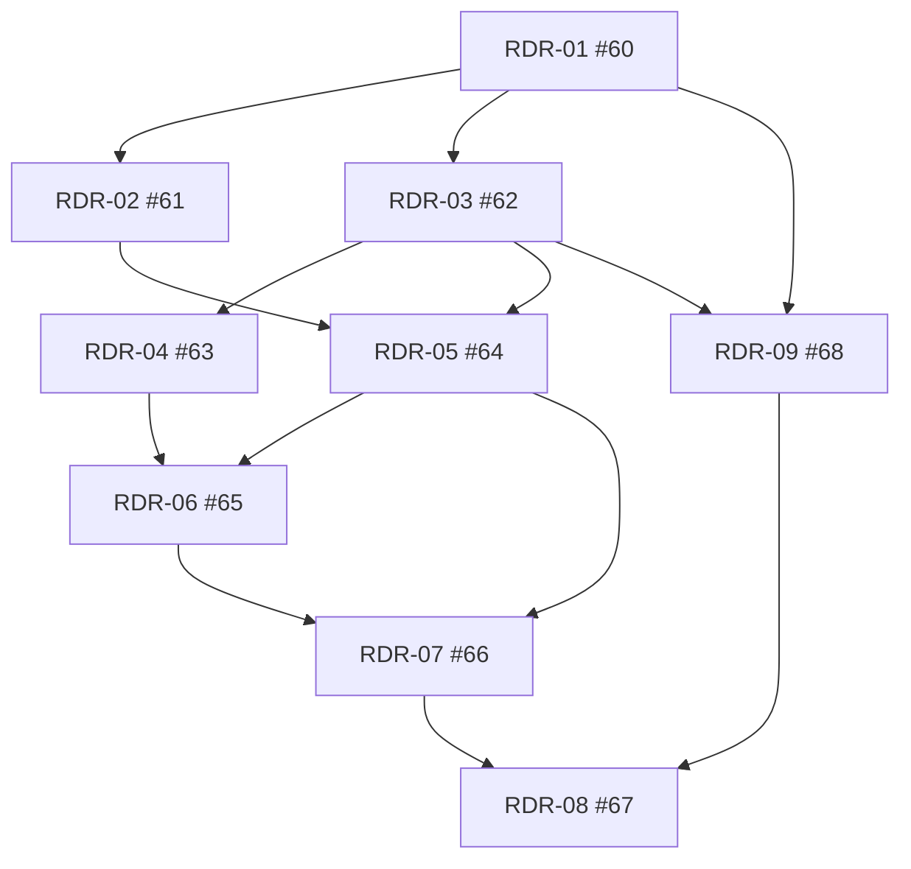

# Planungs- und Refinementnachweis

Stand: 26.10.2026. Ausschließlich Refinement; kein Apply, keine Anwendungsfeatures oder Migrationen. Alle neun Implementierungstasks bleiben offen. Bestehende Änderungen an README.md und apps/dashboard/angular.json gehören nicht zum Commitumfang.

## Ausgangslage und Bestandsprüfung

Anfangsbranch main; lokales HEAD und lesend bestätigtes Remote-main: 4f92ca2eb888a6864f806133ee404e989c445b8b. RDR-Artefakte und docs/development/github-readiness-issue-sync.json waren untracked; kein RDR-Remote-Branch vorhanden. Issues #60–#67 bestanden bereits mit eindeutigen Taskmarkern. Veröffentlichung auf codex/research-data-readiness-refinement.

Gelesen: AGENTS.md, OpenSpec-Konfiguration, alle Visiondokumente, vollständige RDR-Artefakte und Issues, bestehende Research-/Backtest-Spezifikationen und relevante Implementierung. Ein unabhängiger Analyseagent prüfte insbesondere packages/backtesting/dataset.py, calendar.py, coverage.py und Researchstorage. Inklusive +60s-/+300s-Fristen, getrennte Signal-/Outcomesweeps, DB-Ingestion und Snapshotversion bleiben erhalten. Kapitalmaßnahmencoverage muss beim Signal bereits warmStart bis gesamtes fold.testEnd abdecken. Qualitätsrejects benötigen einen einzelnen späteren vollständig abdeckenden VALID-Beleg; Teilbelege lösen sie nicht kumulativ auf.

## Bewertung und Entscheidungen

1. Historische Nachweise: Kritik berechtigt. D7 und REQ-RDR-007/008 trennen Integrität, Quellenauthentizität, zeitliche Authentizität, Vollständigkeit, fachliche Qualität und protokollgebundene Research Eligibility. Signatur und Existenzzeitstempel beweisen keine Veröffentlichung; Selbstzertifikate und eigene Zeitbehauptungen genügen nicht. Heutiger Import bleibt historisch unsichtbar. Widerruf, Schlüsselrotation, Rücknahme und Revision sind append-only; aktuelle Warnprojektion und eingefrorener Bericht bleiben getrennt.
2. Tatsächlich nutzbare Sammlung: Kritik berechtigt. D8/REQ-HMD-009/010 definieren sechs Zeitbedeutungen, unbekannte Messfälle, Latenzquantile mit Stichprobenzahl, exakte Nenner und getrennte maximale Signal-/Outcomeläufe. Barbeobachtung ersetzt keine vollständige Experimentzulässigkeit. Aktuelle Quellenprüfung und Empfehlung eines gegebenenfalls später separat zu planenden Stream-/Aggregationspfads: provider-assessment.md.
3. RDR-03 aufteilen: sinnvoll. Basismigrationen und atomare Evidenzports benötigen keine Kryptografie oder Quellenzulassung. Der unabhängige Trusted Evidence Import wird RDR-09/#68. RDR-04 hängt nur von RDR-03 ab: reine Messreceipts benötigen auch RDR-02 nicht. RDR-05 benötigt RDR-02/03, RDR-09 benötigt RDR-01/03. Gemeinsame Endabnahme RDR-08 benötigt alle anderen Pakete. Kein bisheriges Requirement oder negatives Testszenario entfällt.
4. Git-native Nachvollziehbarkeit: Kritik berechtigt. Die bisher lokalen Artefakte werden zusammen versioniert. Bestehende Issue-IDs bleiben stabil. Managedblocks enthalten Task, Requirements, Pfade, Acceptance, Tests, DoD, offene Status, deterministische Dependencies und direkten Planungsbranchlink. Manuelle Inhalte, Labels und Kommentare bleiben erhalten.

## Dependency Graph

Wesentliche Kanten; vollständige explizite Endabnahmeliste in tasks.md und Syncmapping:

Sammlungspfad: RDR-01 → RDR-03 → RDR-04. Keine Rückkante vom Importer zur Sammlung. Nach Vertragsabnahme RDR-02/03 mit getrennten Dateien; anschließend RDR-04/05/09 unabhängig, danach RDR-06/07 und gemeinsame Abnahme RDR-08.

## Unabhängiger Architektur- und Safetyreview

Ein separater Reviewagent prüfte finale Specs, Design, Taskgraph und konkrete Codepfade. Ein Enumwiderspruch in T-RDR-015 wurde korrigiert und nachgelesen: Vertrauensdimensionen verwenden UNKNOWN/REJECTED, Gesamtzulässigkeit separat BLOCKED. Finale Rückmeldung: kein offener P1/P2-Planungsblocker.

Planungscheckliste: Agenten ohne Orderports; deterministische Risk-/Executiongates und LIVE-Sperre unverändert; Credentials ausschließlich Execution; deaktivierte Defaults; UTC/Decimal; append-only Evidenz/Audit; getrennte Researchpools und harte Workerbudgets; Fencing und Restartregeln; prozessübergreifende Pausebarriere. Tatsächliche Rollenprüfung und Pause/Kill/Reconciliation unter kombinierter Last bleiben spätere Pflichtabnahmefälle. Finanzreservierungen, Submit-/Cancel-/Fillrennen und Jev-Ausfälle bleiben unverändert und benötigen ihre Bestandsregression bei Apply. Dies zertifiziert keine neue Runtime oder reale Provider-/PIT-Eignung.

## Tatsächlich ausgeführte Prüfungen

- OpenSpec context/list/status: lokaler Root und alle Planungsartefakttypen bestätigt.
- ./scripts/openspec.ps1 validate research-data-readiness --strict --json: bestanden, keine Befunde.
- ./scripts/openspec.ps1 validate --all --strict --json: 17/17 bestanden, keine Befunde.
- Gezielte read-only Strukturprüfung: 12 eindeutige Requirements, 29 eindeutige Szenarien, neun eindeutige offene Tasks, vollständige Requirementzuordnung, Acceptance-/Test-/Pfad-/DoD-Felder und topologisch geordneter azyklischer Graph.
- python scripts/scan-source-secrets.py: 973 Quelldateien, 0 Befunde vor abschließender Veröffentlichung.
- Aktueller Einzel-/Repository-Issue-Read-back, Managedblock-SHA256, Status, Marker, native und textuelle Dependencies sowie UTC-Zeit: docs/development/github-readiness-issue-sync.json. Historische Ergebnisse ersetzen keinen aktuellen Read-back.
- Abschließender Read-back: neun eindeutige offene Issues, null Inhaltsupdates bei Wiederholung; vollständiger nativer Graph über die Rückrichtung blocking und die Endknotenzusammenfassung verifiziert. Die blocked_by-Leseoperation von #67 lieferte zeitweise 502; alle acht Voraussetzungen sind nachweislich angelegt. Neue Taskzuordnung RDR-09 → #68, bestehende #60–#67 unverändert zugeordnet.

Keine neuen Runtime-, Last-, Browser- oder Vertragstests ausgeführt: Die Funktionen und Verträge entstehen erst bei Apply. Contract-first und reproduzierbare Clientgenerierung bleiben RDR-01-Abnahmekriterien. Synthetische Autoritäten und HTTPdoubles bestätigen keine realen Nutzungsrechte.

## Werkzeuge und Synchronisierung

Skills: openspec-propose, github-issue-sync, context7-mcp und trading-safety-review. Context7-Auflösung zuerst versucht, Monatsquote erschöpft; deshalb offizielle Alpaca-Dokumentation verwendet, Quellen in provider-assessment.md. Die [GitHub-REST-Referenz](https://docs.github.com/en/rest/issues/issue-dependencies) bestätigt native Dependencies.

Der MCP bietet kein Dependencytool; lesende Issueoperationen funktionierten, sein einmaliger Erstellversuch lieferte 404 ohne Anlage. Anschließend wurde der in AGENTS.md erlaubte GH-CLI-Fallback verwendet. Die ausdrückliche Forderung dieses Refinements nach nativen Abhängigkeiten präzisiert das ältere Syncrunbook mit textuellen Dependencies. Keine Authentifizierung oder globale Konfiguration geändert.

Die automatische Freigabeprüfung konnte einen CLI-Leseaufruf wegen ihres Nutzungslimits nicht ausführen. Nach ausdrücklichem „Weiter“ war die Prüfung wieder möglich. Ein GitHub-502 beim Setzen einer Dependency erforderte idempotente Wiederaufnahme mit erneuter Istprüfung. Temporäre Helfer und strukturierte JSON-Eingaben liegen ausschließlich im ignorierten .tooling/output/.

## Restrisiken und Apply-Grenze

IEX-REST garantiert keine hier nachgewiesene +60s-/+300s-Latenz; persönliche Feed-/Nutzungsrechte bleiben unverifiziert. Ohne unabhängigen Publikationsnachweis bleibt Temporal Authenticity UNKNOWN. Die strenge Kapitalmaßnahmenregel kann sämtliche zukünftigen echten Fenster blockieren. Erste nutzbare Ergebnisse sind deshalb belegte Barzeitfenster, messbare Verzögerungen und konkrete Blocker; eine Mindestzahl zulässiger Backtests wird nicht versprochen. Lockerung oder Retrospective Mode erfordern einen eigenen späteren Change.

Fachlich bereit für einen gesonderten Apply-Auftrag nach bestätigtem Issue-Read-back und Git-Veröffentlichung. CLI-Status „planning complete“ erteilt keine Implementierungsfreigabe. Erster Task bleibt RDR-01; Sammlung und Standarddispatch bleiben aus. Kein Main-Spec-Sync und keine Archivierung in diesem Refinement.
