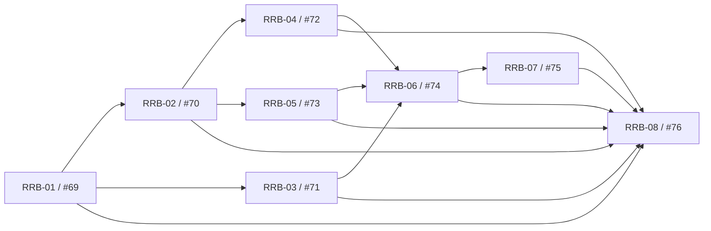

# GitHub-Arbeitspakete

Apply ist seit dem 27.10.2026 freigegeben. RRB-01/#69 ist implementiert und vertragsseitig geprüft; Evidenz: `docs/evidence/rrb-01.md`. RRB-02/#70 ist domainseitig implementiert und unabhängig geprüft; Evidenz: `docs/evidence/rrb-02.md`. RRB-04/#72 ist mit unabhängiger Simulationsprüfung implementiert; Evidenz: `docs/evidence/rrb-04.md`. RRB-05/#73 ist mit unabhängig geprüftem Reliabilityassessor implementiert; Evidenz: `docs/evidence/rrb-05.md`. RRB-03/#71 ist mit realer PG-/ACL-/Restore- und Legacyregression implementiert; Evidenz: docs/evidence/rrb-03.md. RRB-06..08 bleiben offen. Managedblocks enthalten Requirements/Szenarien, konkrete Pfade, Verhalten, Akzeptanz, Tests und DoD. `openspec` und `change:retrospective-research-backtesting` dienen der Zuordnung; kein Milestone angelegt, keine Kommentare oder PRs erstellt.

| Task | Issue | Abhängig von |
|---|---|---|
| RRB-01 Verträge | [#69](https://github.com/fjure/agentic-trading-platform/issues/69) | — |
| RRB-02 Auswahl/Zeitmodelle | [#70](https://github.com/fjure/agentic-trading-platform/issues/70) | #69 |
| RRB-03 Persistenz/ACL | [#71](https://github.com/fjure/agentic-trading-platform/issues/71) | #69 |
| RRB-04 Simulation | [#72](https://github.com/fjure/agentic-trading-platform/issues/72) | #70 |
| RRB-05 Reliability Report | [#73](https://github.com/fjure/agentic-trading-platform/issues/73) | #70 |
| RRB-06 Worker/API | [#74](https://github.com/fjure/agentic-trading-platform/issues/74) | #71, #72, #73 |
| RRB-07 Dashboard | [#75](https://github.com/fjure/agentic-trading-platform/issues/75) | #74 |
| RRB-08 Gesamtprüfung | [#76](https://github.com/fjure/agentic-trading-platform/issues/76) | #69, #70, #71, #72, #73, #74, #75 |

Autoritativer Read-back und SHA256 der verwalteten Blöcke: `docs/development/github-retrospective-issue-sync.json`. Textabhängigkeiten und native `blocked_by`-Kanten müssen exakt übereinstimmen; jede Rückwärtskante wird ebenfalls geprüft. Transport: autorisierter GH-CLI-Fallback nach MCP-Schreibfehler 403. Acht eindeutige Marker, keine Duplikate, keine automatische Taskschließung.
